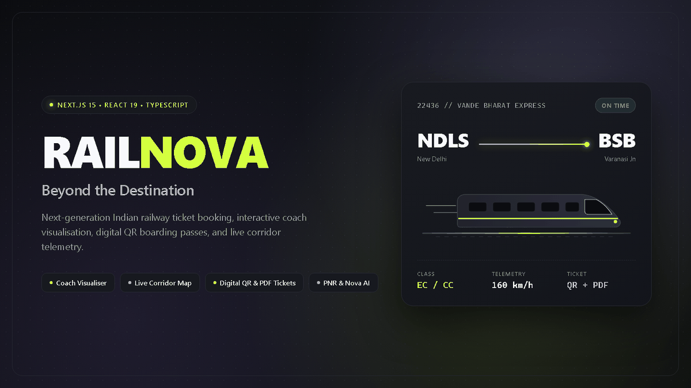

<div align="center">



# RailNova — Beyond the Destination

**Next-Generation Indian Railway Ticket Booking, Coach Visualisation & Live Corridor Telemetry**

[](https://nextjs.org/)
[](https://react.dev/)
[](https://www.typescriptlang.org/)
[](https://tailwindcss.com/)

</div>

---

> **Demonstration Notice:** All train schedules, fares, PNR records, live corridor telemetry, and payment flows in RailNova are simulated locally for demonstration purposes and are **not** valid for official IRCTC travel.

---

## Table of Contents

- [Overview](#overview)
- [Key Features](#key-features)
- [Design System & Color Palette](#design-system--color-palette)
- [Tech Stack](#tech-stack)
- [Project Structure](#project-structure)
- [Getting Started](#getting-started)
- [Environment Variables](#environment-variables)
- [Demo Accounts & Sample PNRs](#demo-accounts--sample-pnrs)
- [API Endpoints](#api-endpoints)
- [Verification & Scripts](#verification--scripts)

---

## Overview

**RailNova** reimagines the Indian railway booking and journey discovery experience with an editorial, dark-first interface, fluid motion choreography, interactive coach seat layouts, real-time corridor tracking, and instant digital e-tickets with QR verification and PDF export.

Built on **Next.js 15 App Router**, **React 19**, and **TypeScript**, the platform runs out-of-the-box with local JSON persistence (`data/railnova-db.json`) and zero external database setup required—while providing optional hooks for PostgreSQL/Supabase, Razorpay Test Mode, and OpenRouter/Gemini-powered intelligence.

---

## Key Features

- **Train Search & Journey Discovery (`/trains`, `/discover`)**
  Search across Vande Bharat, Rajdhani, Shatabdi, and Duronto corridors with class-wise availability, fare breakdowns, and curated scenic route discovery.
- **Interactive Coach Visualisation (`/book`)**
  Inspect coach layouts and berth configurations (`1A`, `2A`, `3A`, `CC`, `EC`, `SL`) with interactive seat selection and passenger detail forms.
- **Smart Booking & Digital E-Tickets (`/book`, `/dashboard`)**
  Generate perforated digital boarding passes with embedded **QR codes** (`qrcode`) and downloadable **PDF tickets** (`jspdf`), plus instant cancellation and refund tracking.
- **Live Corridor Telemetry (`/live-tracking`)**
  Interactive map-based train tracking powered by **MapLibre GL** with station progression, speed/delay telemetry, and corridor status updates.
- **PNR Status Lookup (`/pnr`)**
  Real-time PNR verification supporting Confirmed (`CNF`), Reservation Against Cancellation (`RAC`), and Waitlist (`WL`) status views.
- **Nova AI Travel Assistant**
  Built-in floating assistant (`NovaAI`) providing route guidance, fare insights, and railway intelligence—running deterministically out-of-the-box or enhanced via `OPENROUTER_API_KEY` / `GEMINI_API_KEY`.
- **Traveller Dashboard & Admin Console (`/dashboard`, `/admin`)**
  Manage upcoming bookings, cancellations, and profile sessions as a traveller, or oversee fleet telemetry and platform operations from the admin view.
- **Dual Theme & Motion Craft**
  Obsidian dark mode (`#0C0D10`) and warm ivory light mode (`#F5F2EA`) with **Space Grotesk**, **Manrope**, and **JetBrains Mono** typography, **Framer Motion** transitions, **GSAP** choreography, and `prefers-reduced-motion` support.

---

## Design System & Color Palette

| Token | Dark Mode | Light Mode | Usage |
| :--- | :--- | :--- | :--- |
| `--bg-primary` | `#0C0D10` | `#F5F2EA` | Primary canvas background |
| `--bg-surface` | `#17191F` | `#FFFFFF` | Cards, panels & navigation |
| `--bg-surface-elevated` | `#1E2129` | `#EFECE3` | Elevated modals & interactive surfaces |
| `--accent-primary` | `#D4FF3F` | `#527A00` | Primary CTAs, rail highlights & active states |
| `--accent-lavender` | `#B8A7FF` | `#E5DFFF` | Secondary atmospheric accents & badges |
| `--text-primary` | `#F8F9FC` | `#15171B` | Headings & primary body copy |
| `--text-secondary` | `#9296A3` | `#626672` | Metadata, labels & supporting text |

---

## Tech Stack

| Layer | Technologies |
| :--- | :--- |
| **Framework** | Next.js 15 (App Router), React 19, TypeScript |
| **Styling & UI** | Tailwind CSS v4, Lucide React |
| **Motion & Maps** | Framer Motion, GSAP, MapLibre GL |
| **Tickets & Validation** | `jspdf`, `qrcode`, `zod` |
| **Persistence** | Local JSON store (`data/railnova-db.json`), optional Supabase / PostgreSQL |

---

## Project Structure

```text
Railway-Ticket-Bookings/
├── data/
│   └── railnova-db.json           # Local JSON persistence store
├── public/
│   └── railnova-banner.png        # 16:9 project README banner
├── src/
│   ├── app/
│   │   ├── admin/                 # Admin operations console
│   │   ├── api/                   # REST API routes (auth, trains, bookings, pnr, live, assistant, admin)
│   │   ├── auth/                  # Sign-in & registration pages
│   │   ├── book/                  # Seat selection & ticket booking flow
│   │   ├── dashboard/             # Traveller bookings & cancellations
│   │   ├── discover/              # Curated railway routes & experiences
│   │   ├── live-tracking/         # Live corridor map & telemetry
│   │   ├── pnr/                   # PNR status lookup
│   │   ├── trains/                # Train search & availability
│   │   ├── globals.css            # Design tokens & theme variables
│   │   └── layout.tsx             # Root layout, fonts & global providers
│   ├── components/                # CoachVisualisation, DigitalTicket, NovaAI, Navbar, Footer, etc.
│   └── lib/                       # Auth helpers, DB layer, rate limiter, railway seed data & types
├── .env.example                   # Environment variable template
├── next.config.ts                 # Next.js configuration
├── package.json                   # Scripts & dependencies
└── tsconfig.json                  # TypeScript configuration
```

---

## Getting Started

### Prerequisites

- **Node.js** `18.18+` (or `20+` recommended)
- **npm** `9+`

### Installation & Setup

1. **Clone the repository**

   ```bash
   git clone https://github.com/Sachinxcode-01/railnova.git
   cd railnova
   ```

2. **Install dependencies**

   ```bash
   npm install
   ```

3. **Configure environment variables**

   ```bash
   cp .env.example .env.local
   ```

   Open `.env.local` and set `RAILNOVA_SESSION_SECRET` to a strong random string (at least 32 characters).

4. **Start the development server**

   ```bash
   npm run dev
   ```

5. **Open the application**

   Visit [http://localhost:3000](http://localhost:3000) in your browser.

---

## Environment Variables

| Variable | Required | Description |
| :--- | :--- | :--- |
| `RAILNOVA_SESSION_SECRET` | Yes | 32+ character secret used to sign session tokens |
| `RAILKIT_API_KEY` | No | Optional RailKit key for live Indian Railways feeds |
| `NEXT_PUBLIC_APP_URL` | No | Public base URL (defaults to `http://localhost:3000`) |
| `DATABASE_URL` | No | Optional PostgreSQL connection string |
| `NEXT_PUBLIC_SUPABASE_URL` | No | Optional Supabase project URL |
| `NEXT_PUBLIC_SUPABASE_ANON_KEY` | No | Optional Supabase anonymous key |
| `SUPABASE_SERVICE_ROLE_KEY` | No | Optional Supabase service role key |
| `NEXT_PUBLIC_RAZORPAY_KEY_ID` | No | Optional Razorpay test mode key ID |
| `RAZORPAY_KEY_SECRET` | No | Optional Razorpay test mode secret |
| `OPENROUTER_API_KEY` | No | Optional OpenRouter key for Nova AI |
| `GEMINI_API_KEY` | No | Optional Gemini key for Nova AI |

---

## Demo Accounts & Sample PNRs

Use these pre-seeded accounts to explore traveller and admin workflows immediately:

- **Traveller Account:** `traveler@railnova.demo` / `Travel@RailNova2026`
- **Admin Account:** `admin@railnova.demo` / `Admin@RailNova2026`
- **Demo Mobile OTP:** `123456`
- **Sample PNRs:**
  - `8429104521` — **Confirmed (`CNF`)**
  - `6193048271` — **Reservation Against Cancellation (`RAC`)**

---

## API Endpoints

| Endpoint | Purpose |
| :--- | :--- |
| `GET /api/trains` | Search trains, routes, classes, and seat availability |
| `GET, POST /api/bookings` | List user bookings or create a new ticket reservation |
| `POST /api/cancellations` | Cancel an existing booking and compute refund |
| `GET /api/pnr/[pnr]` | Retrieve live status for a 10-digit PNR number |
| `GET /api/live` | Fetch simulated live corridor telemetry |
| `POST /api/assistant` | Query the Nova AI railway assistant |
| `GET, POST /api/admin` | Admin metrics and fleet management operations |
| `POST /api/auth/*` | Session authentication (`login`, `register`, `logout`, `me`) |

---

## Verification & Scripts

Run static typechecking, linting, and production build checks before deploying:

```bash
npm run typecheck
npm run lint
npm run build
```

To start the production server after building:

```bash
npm run start
```
